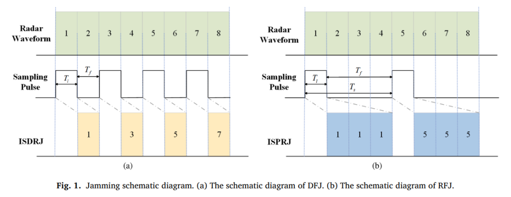
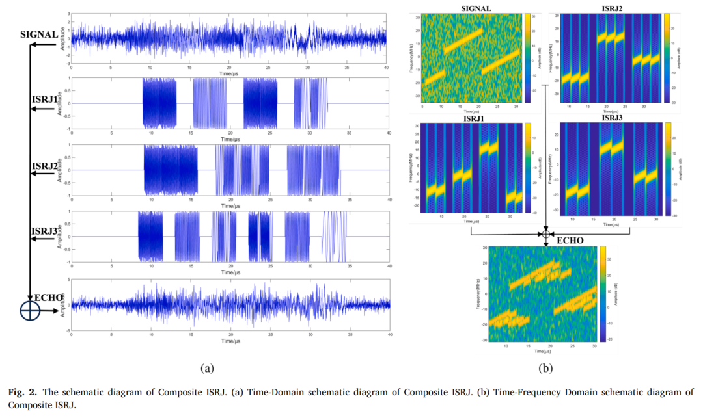
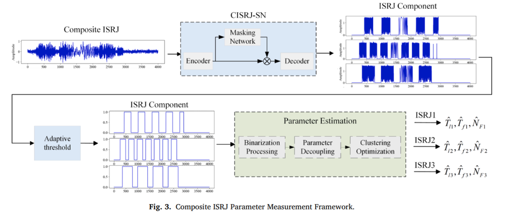
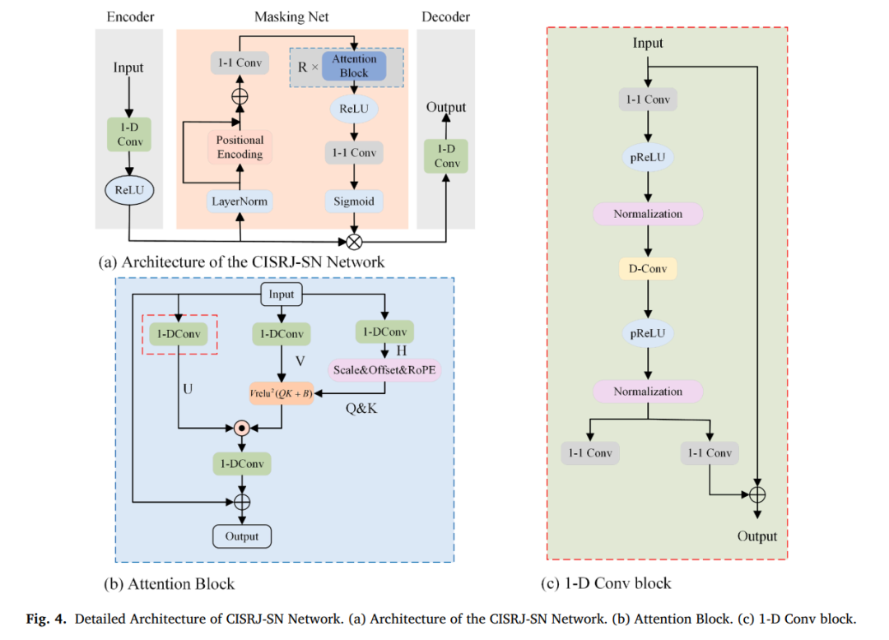
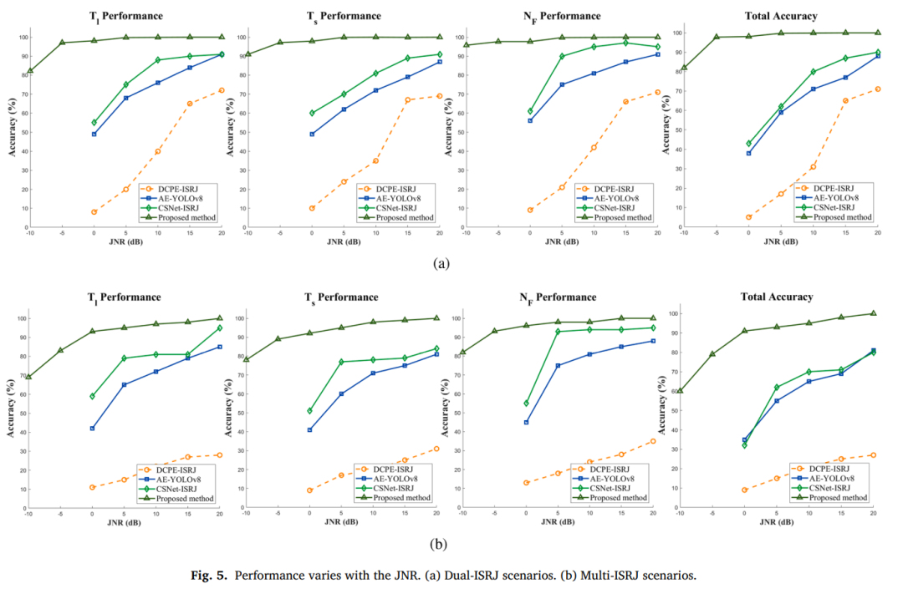
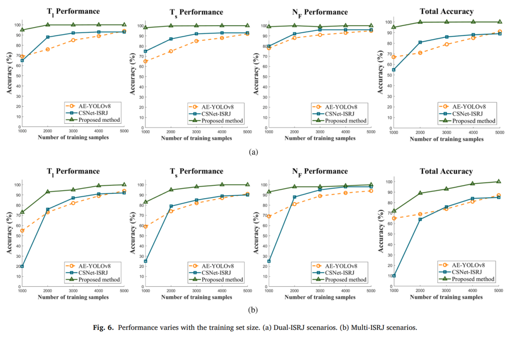
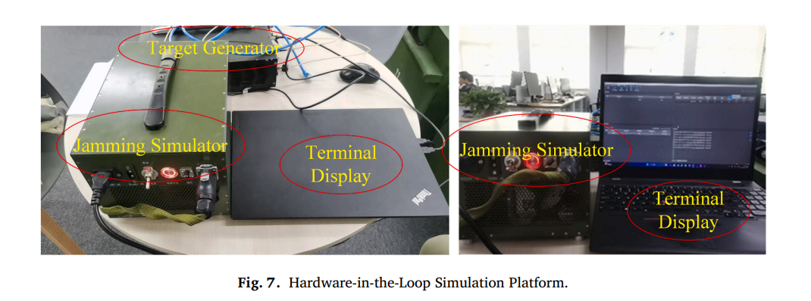
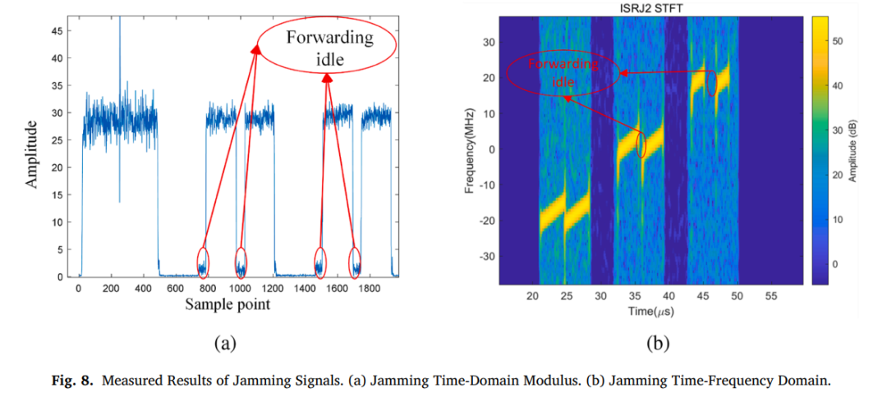
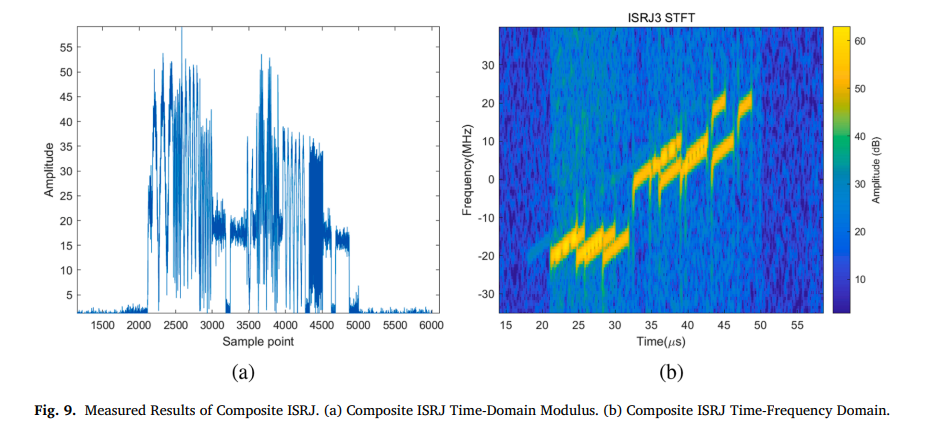
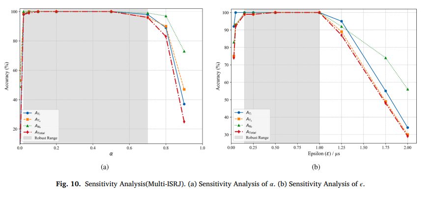

# [Interference Signal Identification] End-to-End Deep Learning Framework: Compound ISRJ Separation and Parameter Estimation with Python Code

Personal Blog: https://www.cnblogs.com/EWFrontier  
✿End-to-end Deep Learning Framework: Composite ISRJ Separation and Parameter Estimation ✿✿Topic ✿A novel end-to-end deep learning framework for the separation of composite Intermittent Sampling Forward Interference (ISRJ) and parameter estimation  
✿Abstract ✿In response to the severe challenges posed by composite Intermittent Sampling Forward Interference (ISRJ) to aerospace radar systems, this paper introduces a novel end-to-end deep learning framework for the simultaneous separation of signals and parameter estimation. The core of this framework is the Customized Deep Separation Network (CISRJ-SN), which employs a unique hybrid attention architecture that integrates one-dimensional convolutions for local feature extraction with gating attention units for global dependency modeling. This enables high-fidelity interference signal separation even under low Interference Noise Ratio (JNR) conditions. Simulation experiments and real hardware in-the-loop results collectively validate the superior performance of this framework: accuracy reaches 99.5% and 94.4% in dual and multi-component scenarios, respectively, showing significant improvements over suboptimal methods; moreover, the framework also boasts exceptional estimation precision, reducing the mean absolute error (MAE) of key parameters by more than 60%, demonstrating its high stability and reliability, offering a promising solution for future intelligent perception and countermeasure closed-loop systems.
Introduction: Advanced radar systems are the core sensing components of modern aerospace platforms, including onboard, satellite-borne, and missile-borne systems, playing a crucial role in navigation, guidance, and battlefield surveillance [1-4]. As an essential component of these systems, advanced antenna technology is the key interface for interacting with the electromagnetic environment, directly affecting the system's operational range, resolution, and interference resistance [5,6]. In fact, a class of anti-interference techniques known as space filtering has been applied at the antenna level, suppressing specific directional interference signals through methods such as adaptive nulls and sidelobe cancellation [7,8]. However, these airborne approaches have inherent limitations when combating complex interference that can enter through the main antenna beams and mimic real target echoes. It is worth noting that Integrated Intermittent Sampling Forwarding Interference (ISRJ) is one of the most powerful threats in this category, utilizing Digital Radio Frequency Memory (DRFM) technology to achieve both suppressive and deceptive tactics, and possesses dynamic parameter reconstruction capabilities, becoming a dominant strong interference mode [9,10].
Existing strategies to counteract ISRJ threats are primarily divided into two categories: active avoidance strategies, which focus on designing new radar waveforms to "avoid" or "destroy" the interference generation process. For example, the pulse-in-time variable frequency waveform proposed in [13] alters signal frequency characteristics to hinder effective tracking and countermeasures by the interferer; while [14,15] optimizes the emission waveform and receiver filters to suppress interference. The main advantage of these methods lies in reducing interference from its source, but their fundamental limitation is that their effectiveness heavily relies on prior knowledge of the intention and pattern of the interference. Therefore, in complex and dynamic electromagnetic environments where the interference patterns are unknown or unpredictable, the robustness and adaptability of these strategies are greatly limited.
This has led to widespread research interest in the second category of strategies, namely passive suppression techniques based on precise estimation of interference parameters. The precise estimation of the type, quantity, and key parameters of composite interference signals is essential for subsequent interference cancellation, filter optimization, or the design of targeted countermeasures [16-19]. The research in this field can be roughly divided into two main stages:
1  
The initial phase is characterized by traditional signal processing methods. At this stage, researchers attempt to utilize artificial features in the pulse-compressed domain or employ time-frequency analysis (TFA) tools for de-interleaving and parameter estimation of ISRJ signals [20,21]. The main advantage of these methods is their strong physical interpretability and relatively low computational complexity; however, a key shortcoming is their sensitivity to Interference Noise Ratio (JNR)—in scenarios with low JNR, important signal characteristics are overwhelmed by noise, leading to a sharp decline in performance. More crucially, in multi-source compound interference scenarios, components of signals often overlap in both the time and frequency domains, resulting in severe parameter coupling, making it difficult for traditional methods to achieve effective decoupling and precise estimation.
2  
Subsequently, to overcome the inherent limitations of traditional methods under low JNR and feature coupling conditions, research has shifted its focus towards deep learning (DL) solutions [22]. Early DL-based approaches enhanced performance by integrating domain-specific features manually designed. For instance, in [23], the use of dual-component ISRJ signals' temporal periodicity for parameter estimation was demonstrated; in [24], the concept of target detection was introduced into this field, employing the AE-YOLOv8 model to draw bounding boxes for individual perturbation components. The main contributions of these studies were the validation of DL's potential in automatic feature extraction, but their limitations stemmed from reliance on specific predefined features: the periodicity utilized in [23] became blurred as the number of perturbation components increased; meanwhile, the boundary box mechanism in [24] proved highly unreliable in low JNR environments. Fundamentally, these methods failed to escape the limitations of manual feature engineering, resulting in limited generalization capabilities.
In summary, to achieve true intelligent processing, this paper proposes a parameter estimation method based on signal separation networks. This method learns the intrinsic representation of signals data-driven, without the need for handcrafted specific features. Targeting the characteristics of composite ISRJ signals, this paper constructs an end-to-end interference separation and parameter estimation framework, introducing a novel separation network CISRJ-SN. This network adopts an advanced encoder-decoder architecture, with a core being a new hybrid attention block that deeply integrates gate-controlled attention units (GAU) specifically designed for efficient modeling of long sequences [25] with one-dimensional convolutional networks. This integration synergistically enhances the model's local feature representation and global dependency modeling capabilities. The proposed overall framework integrates interference separation, pulse detection, and cluster optimization, achieving a direct mapping from raw mixed signal inputs to final parameter outputs, providing key technical support for enhancing the situation awareness and self-defense capabilities of future high-density, highly combative electromagnetic environments for aerospace platforms.
The innovations and contributions of this paper are as follows:
1.  
Proposes a composite ISRJ separation network (CISRJ-SN), a novel interference separation model based on the Gated Single-Head Transformer (GSHT) architecture. By employing a convolutional enhanced self-attention mechanism, this model is the first to simultaneously learn local feature patterns and global long-range dependencies in a unified attention-gated framework, significantly improving interference separation performance and offering a new perspective and method for solving similar problems.
2.  
To overcome the challenge of parameter estimation challenges due to temporal fragmentation of separated signals, proposes a robust algorithm based on pulse detection and cluster optimization. This method integrates adaptive dynamic thresholds, multi-stage pulse segmentation, and advanced clustering algorithms, capable of achieving precise parameter estimation for the characteristics of deinterleaved ISRJ signals.
3.  
The proposed method not only demonstrates high efficiency in linear frequency modulation (LFM) radar signal scenarios but also exhibits outstanding performance when handling hopping frequency (FH) signals, inherently adaptable and flexible making it particularly suitable for systems using diverse radar waveforms.
4.
Compared to existing advanced technologies, the proposed method exhibits higher accuracy, especially under low JNR conditions. Moreover, even when trained on a limited dataset, this method significantly enhances estimation precision in resource-constrained scenarios, providing strong support for data-scarce application domains.

The method introduced in this paper adopts a cascading "separate first, estimate later" design concept, as shown in Figure 3. The overall workflow includes two core modules: the input composite ISRJ signal (composed of multiple interference components and noise) is processed through these stages:

3.1 Interference Separation Stage (CISRJ-SN) The original signal enters the CISRJ-SN network. This core module employs a unique hybrid attention mechanism that can precisely separate each ISRJ component from the highly complex and interwoven input signal. The output of this stage is a set of separated ISRJ component signals, with each signal ideally corresponding to an independent interference source, though fragmentation and residual noise may still exist.

The design of the CISRJ-SN network is based on a thorough analysis of the characteristics of composite ISRJ signals—a type of signal that possesses both "fine-grained local structure" and "global long-range dependencies": temporally composed of numerous discontinuous interference "slices," each containing high-frequency, detailed pulse waveform features (typically local information); at the same time, slices from the same source (especially in RFJ mode) are highly correlated or identical despite being separated by large time intervals, and slices from different sources randomly intertwine, forming complex global contextual relationships.
To address the modeling challenges brought by this dual nature, CISRJ-SN network abandons the time-domain convolutional networks (TCN) in traditional speech separation models like Conv-TasNet[28] and innovatively designs a mask network based on hierarchical hybrid attention. The core "attention block" deeply integrates the powerful local feature extraction capability of one-dimensional convolution (1-D Conv) with the global context awareness ability of GAU[25]. The self-attention mechanism of GAU establishes direct connections between distant but related signal segments, especially adept at modeling the sparse long-range dependencies characteristic of ISRJ signals such as repetitive pulses in RFJ. This collaborative modeling of "local perception" and "global dependency" hybrid architecture effectively addresses the issue of long-term temporal correlation decay caused by the limited receptive field of traditional convolutional networks.
The specific structure of CISRJ-SN network includes:
1.  
Encoder: Composed of one-dimensional convolution blocks and ReLU activation functions, it maps the input sequence to a high-dimensional feature space, providing rich representation for subsequent processing;
2.  
Mask network: The core processing module, including input preprocessing (layer normalization and position encoding), multiple stacked attention blocks (iterative refinement of features through residual connections to enhance training stability), and mask generation (generated mask vectors within [0,1] range through ReLU activation, pointwise convolution, and Sigmoid normalization);
3.  
Decoder: Using transposed convolution layers, symmetrically designed with the encoder, it restores the weighted feature sequence back to the original time-domain resolution without loss, outputting estimated source signals.
3.2 In the parameter estimation stage, each separated ISRJ signal will be independently input into a dedicated parameter estimation module. Through a series of algorithms, key parameters of each interference component are precisely quantified, specifically including:
Adaptive Threshold and Binarization: Converts fragmented signals into a stable binary sequence that represents the "forward/sample" state. The threshold is dynamically set to a fixed proportion of the signal's maximum peak amplitude (here, the coefficient α is set to 0.2). When the signal amplitude exceeds the threshold, it is marked as "forward" (value 1), otherwise, it is marked as "sample" (value 0);
2 
Parameter Decoupling and Clustering Optimization: Extracts raw measurement values for slice width and forward width from the binary sequence. A density-based clustering algorithm is used to eliminate outliers and identify dominant parameter values. Within the cluster, similarity measures are defined: two data points are considered similar if their absolute difference does not exceed a predefined threshold ε (set here to 0.25μs), which is taken as 0.25μs in this case;
3 
Final Parameter Output: Calculates and outputs precise estimation values for each component, including slice width (S), forward width (F), and forward count (N). Here, slice width is taken as the value with the most neighborhood data points in the cluster, forward width is the average of the denoised data in the cluster, and forward count is rounded down from the ratio of forward width to slice width.
✿Conclusion ✿ Compound Intermittent Sampling Forward Interference poses a serious threat to aerospace radar platforms. To mitigate this challenge, this paper proposes an end-to-end parameter estimation framework based on a novel hybrid attention architecture. Simulation experiments and hardware-in-the-loop experiments have confirmed its outstanding performance under complex conditions: achieving an overall measurement accuracy of 94.4% in complex multi-component scenarios, relative to the existing advanced CSNet-ISRJ method by 10.3%; in addition to accuracy, the framework also boasts high precision, reducing the mean absolute error (MAE) of sampling interval estimation by more than 60%, significantly enhancing stability and reliability. Moreover, its robustness has been validated in low JNR environments—even when JNR drops to -5dB, the measurement accuracy of key parameters remains above 90%; furthermore, the framework exhibits excellent data efficiency and adaptability to diverse waveforms such as HF-FM signals, highlighting its potential in enhancing the electromagnetic self-defense capabilities of aerospace platforms.
Despite the encouraging results, this paper has certain limitations: while the training dataset is diverse, it does not encompass all possible ISRJ variants; moreover, pursuing high performance leads to a moderate increase in model complexity. Future work will focus on expanding the dataset, incorporating more complex interference strategies, and applying model compression and data augmentation techniques to enhance real-time performance and generalization capabilities.

## Images

<!-- PAYMENT_BLOCK -->

## Get this dataset

- Payment link (Stripe): [Buy now](https://buy.stripe.com/3cs8yP7sY87d0vu9AB)
- Payment QR code: 

<!-- /PAYMENT_BLOCK -->
